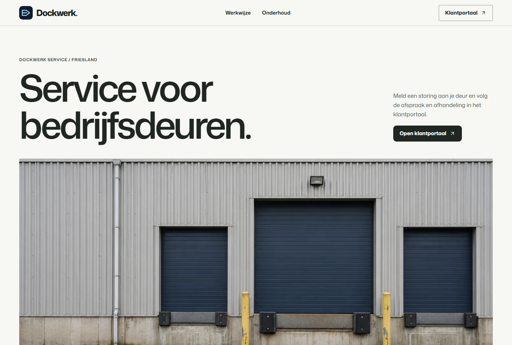

# Dockwerk Service

Een Nederlandstalig serviceportaal voor industriële deuren, gebouwd als portfolioproject voor een stage bij een webbureau. Een klant meldt een storing aan een eigen deur. Een medewerker plant een afspraak in en rondt de melding af. De klant volgt de wijzigingen in een tijdlijn.

[](docs/screenshots/homepage.png)

## Lokaal starten

Gebruik PHP 8.4 met `pdo_sqlite` en `intl`, Composer 2, Node.js 24 en npm. Ga na het klonen naar de projectmap:

```powershell
composer setup
```

Zet daarna in je lokale `.env` de waarde `DOCKWERK_DEMO=true`. De standaardomgeving is `local`. Laad de fictieve gegevens en start de webserver:

```powershell
php artisan db:seed
php artisan serve --host=127.0.0.1 --port=8765
```

Open [Dockwerk op localhost](http://127.0.0.1:8765). De demo gebruikt uitsluitend fictieve gegevens. De seeder kan opnieuw worden uitgevoerd zonder dubbele voorbeeldrecords. De inloghulp verschijnt in de lokale demo en de testomgeving.

## Demo

| Rol | Demoaccount |
| --- | --- |
| Klant · Noordkade Logistiek | `noordkade@dockwerk.test` |
| Werkplaatsmedewerker | `werkplaats@dockwerk.test` |
| Klant · IJsselhaven Opslag | `ijsselhaven@dockwerk.test` |

Demowachtwoord voor alle drie: `dockwerk-demo`.

1. Open het portaal als Noordkade en meld dat **Laadpoort 3** tijdens het openen stilvalt. Bewaar de URL van de melding.
2. Open in een tweede browserprofiel het medewerkersdashboard. Zoek de melding, bekijk de omschrijving en kies **Inplannen**.
3. Vernieuw de melding bij Noordkade en controleer de afspraakdatum. Rond de melding af als medewerker en voeg een korte toelichting toe.
4. Log in als IJsselhaven. De directe URL uit stap 1 geeft een 404. De werkplaatsroute geeft voor een klant een 403.

## Testen

```powershell
php artisan test --compact
php vendor/bin/pint --test
npm run build
npx playwright install chromium
npm run test:browser
```

De PHP-tests gebruiken SQLite in het geheugen. De browsertests starten een eigen Laravel-server en gebruiken een tijdelijke SQLite-database met uitsluitend demodata. De reguliere demo draait apart op poort 8765.

## Verder lezen

- [Datamodel, gebruikersrechten en statuslogica](docs/ARCHITECTUUR.md)
- [Gekozen en beoordeelde skills, tools en referenties](docs/TOOLS.md)
- [Ontwerp en beeld](DESIGN.md) · [Referentieonderzoek](docs/REFERENTIES.md)
- [Ontwikkelstatus en verificatie](docs/VOORTGANG.md)
- [Klantportaal](docs/screenshots/klantportaal.png) · [Werkplaats](docs/screenshots/werkplaats.png) · [Mobiele homepage](docs/screenshots/homepage-mobiel.png) · [Glacier-detail](docs/screenshots/glacier.png)
