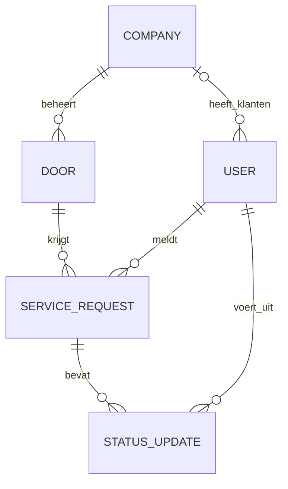

# Architectuur

## Domein

| Begrip | Betekenis |
| --- | --- |
| Bedrijf | Organisatie die deuren beheert. Gegevens zijn per bedrijf afgeschermd. |
| Bedrijfsdeur | Geregistreerde deur met herkenbare naam, unieke code en locatie. |
| Melding | Beschrijving van een storing aan één deur, met status en eventuele afspraakdatum. |
| Statuswijziging | Een tijdlijnregel met status, uitvoerder, tijdstip en eventueel een toelichting. |

Deze versie gebruikt twee rollen. Een klant hoort bij een bedrijf. Een medewerker mag alle meldingen beheren in Filament. Het bedrijf van een melding volgt uit de gekoppelde deur.

## Van formulier tot database

1. [`routes/web.php`](../routes/web.php) koppelt het formulier aan `PortalController::store` en vereist een ingelogde gebruiker. Laravel valideert het CSRF-token.
2. [`PortalController.php`](../app/Http/Controllers/PortalController.php) laat de policy controleren of de gebruiker een melding mag aanmaken. Validatie zoekt de gekozen deur binnen het bedrijf van de gebruiker.
3. Laravel schrijft de melding en de eerste tijdlijnregel samen in een databasetransactie. Als één schrijfopdracht faalt, wordt de andere teruggedraaid.
4. De redirect opent de detailpagina. [`ServiceRequestPolicy.php`](../app/Policies/ServiceRequestPolicy.php) controleert opnieuw het bedrijf. Een verzoek van een andere klant krijgt een 404, ook met een geraden nummer of een directe link.

## Statussen

**Gemeld → Ingepland → Afgerond**

- Een medewerker plant een gemelde storing in voor vandaag of later. De afspraakdatum wordt als kalenderdatum bewaard.
- Een ingeplande melding kan worden afgerond met een optionele, klantzichtbare toelichting.
- [`TransitionServiceRequest.php`](../app/Actions/TransitionServiceRequest.php) controleert de rechten en voert de overgang uit. De update slaagt alleen als de huidige status nog overeenkomt met de verwachte status. Dat houdt herhaalde acties en de tijdlijn consistent.
- [`ServiceRequestResource.php`](../app/Filament/Resources/ServiceRequestResource.php) gebruikt deze PHP-acties vanuit het medewerkersdashboard. De zichtbaarheid van een knop bepaalt welke acties de gebruiker te zien krijgt. De action en policy bepalen welke acties hij daadwerkelijk mag uitvoeren.

## Zelf uitleggen bij het stagegesprek

Volg in de code één melding van `routes/web.php` naar de controller, de policy, het Eloquent-model en de Blade-view. Wijs vervolgens het [PHP-testbestand](../tests/Feature/ServicePortalTest.php) aan waarin een ander bedrijf wordt geweigerd. In de [browsertest](../tests/browser/portal.spec.js) zie je dezelfde controle vanuit drie afzonderlijke browsersessies.

## Scope van deze demo

Het eerste project ondersteunt een datum bij een melding, één rechtenset voor medewerkers en fictieve gegevens. Een monteursrooster, e-mails, bestandsuploads, hosting en integraties vragen een afzonderlijke uitbreiding.
